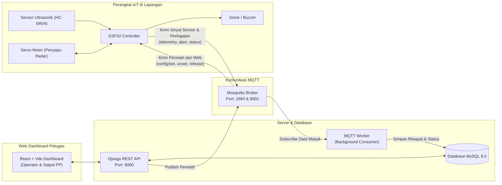

# SLOP — Sistem Pencegahan Parkir Liar & PKL di Bahu Jalan

Sistem pemantauan bahu jalan berbasis IoT (**ESP32**) dan Web Dashboard terintegrasi (**Django REST Framework**, **MySQL**, **MQTT Mosquitto**, dan **React Vite**). Sistem ini berfungsi mendeteksi kendaraan yang parkir liar atau pedagang kaki lima (PKL) yang memakan bahu jalan melebihi batas waktu toleransi, menyalakan sirine alarm di lokasi, dan mengirimkan notifikasi peringatan ke ruang pantau petugas secara *real-time*.

---

## Daftar Isi
1. [Arsitektur Sistem](#arsitektur-sistem)
2. [Prasyarat (Prerequisites)](#prasyarat-prerequisites)
3. [Cara Menjalankan Web & Server (Backend, Frontend, MQTT, Database)](#cara-menjalankan-web--server)
   - [Metode 1: Menggunakan Docker Compose (Direkomendasikan)](#metode-1-menggunakan-docker-compose-sangat-direkomendasikan)
   - [Metode 2: Menjalankan Manual Tanpa Docker](#metode-2-menjalankan-manual-tanpa-docker)
4. [Cara Menjalankan Bagian IoT (ESP32 Firmware)](#cara-menjalankan-bagian-iot)
   - [Opsi A: Simulasi di Wokwi (Tanpa Alat Fisik)](#opsi-a-simulasi-di-wokwi-tanpa-alat-fisik)
   - [Opsi B: Menggunakan Alat Fisik ESP32](#opsi-b-menggunakan-alat-fisik-esp32)
5. [Daftar Port & Akun Pengguna Bawaan](#daftar-port--akun-pengguna-bawaan)
6. [Alur Pengujian Sistem dari IoT hingga Web](#alur-pengujian-sistem-dari-iot-hingga-web)
7. [Panduan Pemecahan Masalah (Troubleshooting & FAQ)](#panduan-pemecahan-masalah-troubleshooting--faq)

---

## Arsitektur Sistem



- **ESP32**: Memutar servo penyapu sambil mengukur jarak bahu jalan. Jika objek terdeteksi lebih dekat dari batas toleransi dan bertahan melebihi durasi waktu yang ditentukan, alarm mengunci (*latched*) dan sinyal peringatan dikirim.
- **Mosquitto**: Menghubungkan ESP32 dengan sistem backend secara cepat dan ringan melalui protokol MQTT.
- **MQTT Worker**: Berjalan di latar belakang untuk mencatat setiap deteksi sensor dan riwayat insiden ke database MySQL.
- **Django REST API**: Menyediakan endpoint autentikasi JWT, data perangkat, pengaturan jarak/timeout, serta modul analitik statistik.
- **React Frontend**: Antarmuka visual responsif bagi Operator dan personel Satpol PP untuk memantau radar lapangan, menerima alarm bahu jalan, serta melihat analitik riwayat pelanggaran.

---

## Prasyarat (Prerequisites)

### 1. Untuk Menjalankan Web & Server
- **Git** terpasang di komputer Anda.
- **Docker Desktop** (versi terbaru) — *Sangat direkomendasikan karena otomatis memasang Python, Node.js, MySQL, dan Mosquitto tanpa perlu instalasi manual satu per satu.*
- *(Alternatif jika tidak memakai Docker)*:
  - Python 3.10 atau lebih baru.
  - Node.js versi 18 atau 20 ke atas (dengan `npm`).
  - Server MySQL 8.0 aktif.
  - Mosquitto MQTT Broker aktif.

### 2. Untuk Menjalankan IoT (ESP32)
- **Visual Studio Code (VS Code)**.
- Ekstensi VS Code wajib:
  1. **PlatformIO IDE** (untuk kompilasi dan upload firmware).
  2. **Wokwi Simulator** (jika ingin mencoba simulasi tanpa alat fisik).
- *(Jika menggunakan perangkat keras fisik)*:
  - 1x ESP32 DevKit Board (30 atau 38 pin).
  - 1x Sensor Ultrasonik HC-SR04.
  - 1x Micro Servo SG90.
  - 1x Buzzer Aktif atau Pasif.
  - 1x Breadboard dan kabel jumper (Male-to-Female / Male-to-Male).
  - Resistor pembagi tegangan (1kΩ dan 2kΩ) untuk pin ECHO ke ESP32 (agar tegangan 5V HC-SR04 aman bagi pin 3.3V ESP32).
  - Kabel data USB (Micro-USB atau USB-C sesuai tipe board ESP32).

---

## Cara Menjalankan Web & Server

### Metode 1: Menggunakan Docker Compose (Sangat Direkomendasikan)

Hanya perlu satu langkah dan seluruh sistem (MySQL, MQTT Broker, MQTT Worker, Backend API, dan Frontend UI) langsung berjalan.

1. **Buka terminal** dan masuk ke folder proyek:
   ```bash
   cd "sic-project-app"
   ```

2. **Buat file konfigurasi lingkungan (`.env`)**:
   Salin dari template `.env.example`:
   - Di Windows PowerShell:
     ```powershell
     cp .env.example .env
     ```
   - Di Linux / macOS:
     ```bash
     cp .env.example .env
     ```

   > [!TIP]
   > File `.env` sudah memiliki pengaturan *default* yang langsung cocok untuk dijalankan di komputer lokal. Jika port `8080` di komputer Anda sudah terpakai oleh aplikasi lain, Anda cukup menambahkan atau mengubah baris berikut di file `.env`:
   > ```env
   > FRONTEND_PORT=8081
   > ```

3. **Jalankan seluruh layanan dengan Docker Compose**:
   ```bash
   docker compose up --build -d
   ```
   *Catatan: Proses pertama kali akan mengunduh image dan memakan waktu 2–5 menit tergantung kecepatan internet Anda.*

4. **Periksa status layanan**:
   ```bash
   docker compose ps
   ```
   Pastikan kelima kontainer berikut berstatus `Up` / `Healthy`:
   - `sic-project-app-mysql-1`
   - `sic-project-app-mosquitto-1`
   - `sic-project-app-backend-1`
   - `sic-project-app-mqtt-worker-1`
   - `sic-project-app-frontend-1`

5. **Akses antarmuka web**:
   - Buka browser Anda dan kunjungi: **`http://localhost:8080`** (atau `http://localhost:8081` jika port diubah).

---

### Metode 2: Menjalankan Manual Tanpa Docker

Jika Anda ingin menjalankan komponen secara terpisah untuk keperluan *debugging* lokal:

#### A. Database & Broker MQTT
1. Pastikan server **MySQL** berjalan dan buat database bernama `slop`:
   ```sql
   CREATE DATABASE slop CHARACTER SET utf8mb4 COLLATE utf8mb4_unicode_ci;
   CREATE USER 'slop'@'localhost' IDENTIFIED BY 'slop';
   GRANT ALL PRIVILEGES ON slop.* TO 'slop'@'localhost';
   FLUSH PRIVILEGES;
   ```
2. Pastikan **Mosquitto** berjalan di port `1883`.

#### B. Menjalankan Backend Django & Worker
1. Masuk ke folder backend:
   ```bash
   cd backend
   ```
2. Buat dan aktifkan virtual environment Python:
   ```bash
   python -m venv venv
   # Di Windows:
   venv\Scripts\activate
   # Di Linux / macOS:
   source venv/bin/activate
   ```
3. Install dependensi:
   ```bash
   pip install -r requirements.txt
   ```
4. Jalankan migrasi dan buat data awal akun demo:
   ```bash
   python manage.py migrate
   python manage.py bootstrap_demo
   ```
5. Jalankan server API (Terminal 1):
   ```bash
   python manage.py runserver 0.0.0.0:8000
   ```
6. Jalankan MQTT Worker pencatat telemetri (Terminal 2):
   ```bash
   python manage.py run_mqtt
   ```

#### C. Menjalankan Frontend React
1. Buka terminal baru dan masuk ke folder frontend:
   ```bash
   cd frontend
   ```
2. Install dependensi Node.js:
   ```bash
   npm install
   ```
3. Jalankan server pengembang:
   ```bash
   npm run dev
   ```
4. Buka alamat lokal yang muncul di terminal (biasanya `http://localhost:5173`).

---

## Cara Menjalankan Bagian IoT

Di dalam folder proyek terdapat folder `iot/` yang berisi kode firmware ESP32:
- `iot/device-1/`: Firmware unit lapangan 1 (ID default: `a4ca5bbb-f98c-4add-af1e-a498c9868dcc`).
- `iot/device-2/`: Firmware unit lapangan 2 (ID default: `e5bf08a0-137f-4451-a33c-f3f551c5312b`).

Pilih salah satu metode di bawah ini:

### Opsi A: Simulasi di Wokwi (Tanpa Alat Fisik)

Metode ini paling cepat karena Anda tidak memerlukan perangkat keras fisik.

1. **Buka folder perangkat di VS Code**:
   - Buka menu `File` > `Open Folder...` > pilih folder `iot/device-1`.
2. **Kompilasi firmware terlebih dahulu**:
   - Buka terminal PlatformIO di VS Code, lalu ketik:
     ```bash
     pio run
     ```
   - Tunggu sampai muncul status `[SUCCESS]`.
3. **Mulai simulasi Wokwi**:
   - Buka file `diagram.json` yang ada di dalam folder `iot/device-1/`.
   - Klik tombol hijau **Play / Start Simulation** yang ada di bagian atas tampilan visual rangkaian Wokwi.
4. **Koneksi MQTT Otomatis**:
   - Firmware Wokwi sudah dikonfigurasi terhubung ke `host.wokwi.internal:1883`.
   - Selama Mosquitto di Docker sudah berjalan, ESP32 virtual akan langsung terhubung ke broker MQTT di komputer Anda.
   - Status di web dashboard akan otomatis berubah menjadi **Online / Aktif**.

---

### Opsi B: Menggunakan Alat Fisik ESP32

1. **Rangkaian Pengkabelan (Unit Default - Unit 0)**:

   | Komponen | Pin ESP32 (GPIO) | Keterangan |
   |---|---|---|
   | HC-SR04 VCC | 5V / VIN | Sumber daya sensor |
   | HC-SR04 GND | GND | Ground bersama |
   | HC-SR04 TRIG | **GPIO 22** | Trigger pulsa ultrasonik |
   | HC-SR04 ECHO | **GPIO 21** | Gema ultrasonik *(Gunakan pembagi tegangan 5V→3.3V)* |
   | Servo V+ (Kabel Merah) | 5V / VIN | Daya motor servo |
   | Servo GND (Kabel Cokelat/Hitam) | GND | Ground motor servo |
   | Servo PWM (Kabel Oranye/Kuning) | **GPIO 23** | Sinyal kendali sudut servo |
   | Buzzer Positif (+) | **GPIO 19** | Pin sinyal alarm/sirine |
   | Buzzer Negatif (-) | GND | Ground buzzer |

2. **Sesuaikan Pengaturan Wi-Fi & IP Komputer**:
   Buka file `iot/device-1/src/main.cpp`, cari baris 98–104 dan ubah sesuai jaringan Wi-Fi Anda:
   ```cpp
   static const char *WIFI_SSID = "NAMA_WIFI_RUMAH_ANDA";
   static const char *WIFI_PASSWORD = "PASSWORD_WIFI_ANDA";
   static const char *MQTT_HOST = "192.168.1.XX"; // Masukkan IP komputer lokal Anda di jaringan Wi-Fi
   static const uint16_t MQTT_PORT = 1883;
   static const char *MQTT_USERNAME = "sicuser";
   static const char *MQTT_PASSWORD = "s1cu53rp455w0rd";
   ```

3. **Upload Firmware ke ESP32**:
   - Sambungkan board ESP32 ke laptop menggunakan kabel data USB.
   - Buka terminal di folder `iot/device-1`, lalu jalankan:
     ```bash
     pio run -t upload
     ```
4. **Buka Serial Monitor**:
   ```bash
   pio device monitor -b 115200
   ```
   Anda akan melihat log koneksi Wi-Fi berhasil dan perangkat siap mengirim data sensor setiap 5 detik.

---

## Daftar Port & Akun Pengguna Bawaan

### Cheatsheet Port Layanan

| Layanan | Alamat URL / Port | Keterangan |
|---|---|---|
| **Web Dashboard** | `http://localhost:8080` | Antarmuka pengguna bagi Operator dan Satpol PP |
| **Django REST API** | `http://localhost:8000/api/` | Backend REST API & Dokumentasi endpoint |
| **MQTT Broker (TCP)** | `localhost:1883` | Port komunikasi data ESP32 & MQTT Worker |
| **MQTT Broker (WebSocket)** | `localhost:9001` | Port MQTT untuk klien berbasis web |
| **MQTTX Web Client** | `http://localhost:8088` | Alat bantu inspeksi pesan MQTT lewat browser |
| **Database MySQL** | `localhost:3306` | Penyimpanan data relasional |

### Akun Login Demo

Sistem telah menyediakan akun awal otomatis saat server pertama kali dijalankan:

| Peran (Role) | Username | Password | Hak Akses |
|---|---|---|---|
| **Operator** | `operator` | `operator123` | Akses penuh: Pemantauan, Analisis, Kelola Perangkat, Tambah/Hapus Unit Sensor, Manajemen Pengguna |
| **Satpol PP** | `satpol` | `satpol123` | Akses lapangan: Pemantauan, Analisis, Konfirmasi Penertiban Pelanggaran (Release Alarm) |

---

## Alur Pengujian Sistem dari IoT hingga Web

Untuk memverifikasi bahwa seluruh rangkaian sistem bekerja dengan benar:

1. **Masuk ke Dashboard**:
   - Buka `http://localhost:8080` di browser.
   - Masuk menggunakan akun `operator` / `operator123`.

2. **Periksa Halaman Pemantauan**:
   - Masuk ke menu **Pemantauan**.
   - Pastikan kartu perangkat menampilkan status **Online** dengan visualisasi sudut servo yang bergerak dan jarak pantauan sensor diperbarui setiap 5 detik.

3. **Simulasikan Pelanggaran Bahu Jalan**:
   - Di simulator Wokwi (atau pada alat fisik), dekatkan objek ke depan sensor HC-SR04 dengan jarak kurang dari batas toleransi (default: **< 10 cm**).
   - Tunggu hingga durasi timeout terlampaui (untuk pengujian cepat, Anda dapat mengubah batas timeout menjadi 5–10 detik melalui menu **Kelola Perangkat**).
   - Saat batas waktu habis:
     - Buzzer di alat/Wokwi akan **berbunyi terus menerus**.
     - Di web dashboard muncul **notifikasi darurat bahu jalan** berwarna merah berkedip.

4. **Penyelesaian oleh Petugas (Release Alarm)**:
   - Klik tombol **Selesaikan / Matikan Alarm** pada kartu peringatan di dashboard web.
   - Perintah `release` akan dikirim lewat MQTT ke ESP32: sirine/buzzer akan langsung padam, dan status insiden tercatat sebagai **Sudah Selesai**.

5. **Lihat Hasil pada Menu Analisis**:
   - Buka menu **Analisis**.
   - Tab **Ringkasan**: Menampilkan total kejadian, tingkat penanganan, dan waktu respon petugas.
   - Tab **Riwayat Pelanggaran**: Menampilkan histogram lama parkir liar, grafik pelanggaran per titik, tabel data, serta tombol **Unduh Data (CSV)**.
   - Tab **Kondisi Alat & Sensor**: Menampilkan kestabilan sinyal sensor, grafik toleransi batas bahu jalan, serta riwayat alat jika sempat padam/offline.
   - Tab **Daftar Titik & Alat**: Menampilkan daftar alat lapangan beserta posisi GPS dan kondisi komponen pin hardware.

---

## Panduan Pemecahan Masalah (Troubleshooting & FAQ)

### 1. Port 8080 sudah dipakai oleh aplikasi lain di Windows
**Penyebab:** Pada Windows, port `8080` kerap digunakan oleh service sistem lokal.
**Solusi:**
Buka file `.env`, lalu ganti port frontend ke `8081`:
```env
FRONTEND_PORT=8081
```
Lalu jalankan ulang kontainer frontend:
```bash
docker compose up -d frontend
```
Akses web dashboard di `http://localhost:8081`.

### 2. Wokwi tidak bisa terhubung ke MQTT (`MQTT connection failed`)
**Penyebab:** Wokwi berjalan di sandbox cloud dan memerlukan gateway lokal agar bisa mengakses port `1883` di laptop Anda (`host.wokwi.internal`).
**Solusi:**
- Pastikan kontainer `mosquitto` di Docker dalam keadaan berjalan (`docker compose ps`).
- Pastikan ekstensi Wokwi di VS Code sudah terhubung ke akun Wokwi Anda.
- Jika simulasi di Wokwi web langsung, gunakan bridge Wokwi IoT Gateway atau arahkan broker ke IP publik / broker cloud sementara.

### 3. ESP32 Fisik gagal terhubung ke Wi-Fi / MQTT
**Penyebab:** ESP32 hanya mendukung sinyal Wi-Fi frekuensi **2.4 GHz** (tidak bisa mendeteksi Wi-Fi 5 GHz).
**Solusi:**
- Pastikan hotspot laptop atau router Wi-Fi Anda menggunakan frekuensi 2.4 GHz.
- Pastikan firewall Windows/antivirus tidak memblokir port `1883` untuk koneksi dari jaringan lokal.
- Cek IP laptop Anda dengan perintah `ipconfig` (Windows) atau `ifconfig` (Linux), dan pastikan nilai `MQTT_HOST` di `main.cpp` sama persis dengan IP tersebut.

### 4. Status Alat di Web tetap "Offline"
**Penyebab:** ESP32 belum mengirimkan laporan status awal atau kontainer `mqtt-worker` belum berjalan.
**Solusi:**
- Cek log worker dengan perintah: `docker compose logs -f mqtt-worker`.
- Reset board ESP32 (tekan tombol EN/RST) agar mengirimkan pesan *handshake* `config/status`.

---

## Lisensi & Kontributor

Dikembangkan sebagai solusi teknologi cerdas pencegahan parkir liar dan penataan ruang publik bahu jalan (**SIC Batch 8**). Bebas digunakan dan dikembangkan untuk keperluan akademik dan pelayanan masyarakat.
